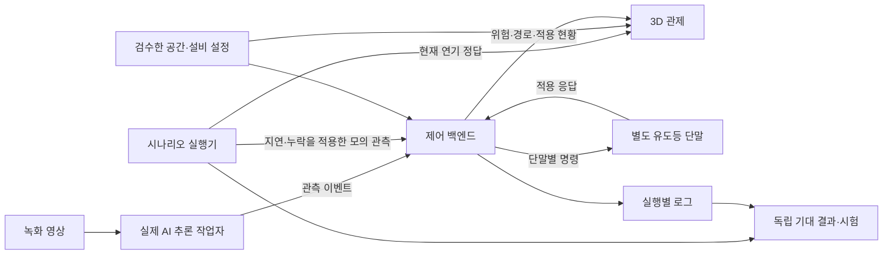

# saferoute 시스템 상세설계서

[기획서](01-project-proposal.md) · [요구사항](03-requirements-spec.md) · [공통 데이터·API](05-data-interface-spec.md)

설계 상태는 **구현 기준안**이다. 이 문서는 모듈 책임, 판단 순서, 공간·연기·단말 처리와 배포 구조를 정의한다. 자료형·엔드포인트·오류 이름은 05번 문서를 기준으로 한다.

## 1. 구성과 책임 경계



- 제어 백엔드에는 공간 설정과 관측 이벤트만 들어간다. 연기 정답·미래 상태·시험 기대 경로는 입력하지 않는다.
- AI는 관측을 제공하며 최종 통로 차단·출구·화살표를 결정하지 않는다.
- 프론트는 서버 판단을 표시하며 경로를 다시 계산하지 않는다.
- 별도 단말은 관제와 독립적으로 API를 조회한다. 관제 컴포넌트의 자식 화면으로만 구현하지 않는다.
- S3 저장 실패가 경로 계산을 막지 않도록 실행 중 로컬 로그와 종료 후 업로드를 분리한다.

## 2. 프로세스와 모듈

| 모듈 | 입력 | 출력 | 소유 |
| --- | --- | --- | --- |
| ai_worker.inference | 영상·가중치·설정 | 실제 박스·클래스·confidence·분석 상태 | 1 |
| ai_worker.events | 실제 추론 결과 | 관측 이벤트 | 1 |
| schemas | JSON | 검증된 객체·오류 | 2 |
| config | 건물·설비·실행 설정 | 참조 검사 완료 구조 | 2·4 |
| state | 관측·만료·해제 | 원인별 경보·관측 유효성 | 2 |
| routing | 그래프·차단·출구 | 노드별 다음 지점·목적지·사유 | 2 |
| guidance | 경로·표시면 매핑 | 안내 스냅샷·단말 명령 | 2 |
| audit | 사건·판단·명령·응답 | JSONL·실행 manifest | 2 |
| scenario_runner | 시나리오·가상 설비 | 모의 이벤트·현재 연기 정답 | 2, 5 자료 |
| BuildingScene·SmokeLayer | 공간·관측 스냅샷·연기 정답 | 관제 장면 | 3, 4 공간 |
| SignTerminal·commandGuard | 단말 명령 | 표시·ACK·만료 상태 | 3 |
| verify_run | 로그·독립 기대 결과 | 판정·근거·누락 | 2, 5 검수 |

FastAPI는 한 worker로 동작한다. 초기 규모에서는 분산 캐시·메시지 브로커·멀티 서버를 사용하지 않는다. AI 추론을 API 핸들러 내부에서 호출하지 않는다.

## 3. 제어기 실행 상태

### 3.1 시작·종료·초기화

1. 설정과 공간 데이터를 검증한다. 실패하면 서버가 정상 준비 상태라고 응답하지 않는다.
2. 새 run_id와 INITIALIZING 상태를 생성하고 설정·모델·코드 정보를 기록한다.
3. 관측을 수신하되 기본 방향을 자동 활성화하지 않는다.
4. 필수 관측원이 유효하고 운영자가 현재 run_id로 arm하면 판단 상태에 따라 NORMAL 또는 EMERGENCY로 진입한다.
5. 종료 시 로그를 정리한다. reset은 이전 실행을 종료·보존하고 새 run_id로 시작한다.

프로토타입의 재시작은 이전 경보를 복원해 곧바로 운전하는 기능이 아니다. 새 실행에서 관측과 명시적 시작을 다시 확인한다. 실제 제품에서는 영속 경보·장치 상태 복구 정책이 추가 검증 대상이다.

### 3.2 상태 전이

| 조건 | 제어 모드 | 표시 원칙 |
| --- | --- | --- |
| arm 전 | INITIALIZING | 방향 없음, 준비 중 |
| arm 후, 활성 경보 없음, 필수 관측 유효 | NORMAL | 검수된 기본 안내 |
| arm 후, 활성 경보 하나 이상 | EMERGENCY | 위험·필수 관측 불가를 제외한 동적 안내 |
| arm 후, 경보 없음, 필수 관측 불가 | DEGRADED | 정상임을 확인할 수 없는 상태. 기본 방향을 자동 유지하지 않음 |
| 시스템 오류로 판단 불가 | DEGRADED 또는 응답 실패 | 단말 유효기간 만료·UNKNOWN |

EMERGENCY 중 일부 구역을 관측할 수 없으면 해당 구역을 제외하고 남은 경로를 계산할 수 있다. 그 결과가 실제 건물 전체의 안전을 보장하는 것은 아니다.

### 3.3 원인과 유효성

경보 원인별 상태는 다음처럼 독립적으로 유지한다.

```text
(CAM-A, FIRE) = ACTIVE
(DETECTOR-A, SMOKE) = ACTIVE
(SPRINKLER-A, SPRINKLER) = INACTIVE

CAM-A validity = STALE
DETECTOR-A validity = VALID
```

CAM-A가 끊겨도 FIRE 원인은 유지된다. CAM-A의 미검출로 DETECTOR-A의 SMOKE를 지우지 않는다. 하나의 구역이 NORMAL/HOT처럼 단일 플래그만 가지면 원인별 해제를 표현하기 어려우므로 원인 목록에서 구역 상태를 도출한다.

## 4. 입력 처리와 동시성

### 4.1 처리 절차

```text
요청 수신
→ 자료형·식별자·출처·실행·시각·순번 검사
→ 중복 또는 거부 기록
→ 수락 이벤트 기록
→ 원인·관측 상태 갱신
→ 차단 집합 계산
→ 경로·표시면 결과 계산
→ 불변 스냅샷으로 교체
→ 명령·상태 API가 같은 결과 읽기
```

만료 작업과 API의 상태 변경은 같은 잠금 또는 직렬 큐로 처리한다. 클라이언트 요청 중간에 위험은 새 버전인데 경로는 이전 버전인 객체를 내보내지 않는다. 단순 구현에서는 한 프로세스의 잠금과 스냅샷 교체로 충분하다.

신선도는 수신 시각만으로 갱신하지 않는다. 기본 구성의 생산자·제어기는 같은 서버 시계를 쓰며, 관측 시각으로 입력 나이를 확인하고 남은 유효기간을 monotonic 기한으로 전환한다. HTTP 재시도가 관측 수명을 늘리면 안 된다.

### 4.2 계산 촉발 조건

- 새 활성 경보, 지정 원인 해제.
- 필수 관측원의 유효성 변화·만료·복구.
- 명시적으로 반영한 통행·출구 조건 변경.
- 초기 arm과 실행 초기화.

영상 매 프레임·프론트 렌더링마다 전체 경로를 계산하지 않는다. 판단 입력이 바뀌었을 때 계산하며 같은 상태의 반복 입력은 중복 효과를 내지 않는다. 적용할 설정을 바꾸면 건물/설정 버전을 갱신하고 새 실행에서 검증한다.

## 5. 경로 알고리즘

### 5.1 그래프 구성

- 노드: 복도 분기점, 출입구, 계단 접속점, 출구.
- edge: 방향이 있는 실제 이동 연결. 양방향 통로는 두 edge.
- cost: 양수 모델 비용. 실측되지 않은 거리에서 실제 피난 시간을 추론하지 않는다.
- 구역: 위험 관측이 영향을 주는 노드·edge의 명시 목록.
- 출구: 허용 목적지와 사용 조건. 단순히 층 가장자리라는 이유로 출구로 생성하지 않는다.

### 5.2 후보 제거

원본 그래프에서 아래를 제외한 실행용 그래프를 만든다.

1. 활성 경보 구역의 blocked_node_ids·blocked_edge_ids.
2. traversable=false인 연결.
3. EMERGENCY에서 필수 관측이 유효하지 않은 구역의 지정 연결·노드.
4. 사용 불가능한 출구. 목적지가 여러 개면 유효한 출구만 남긴다.

노드를 제거하면 인접 edge도 제거한다. 위험을 큰 비용으로 바꾸어 최후 수단으로 통과시키지 않는다.

### 5.3 다중 출구 역방향 Dijkstra

1. 유효한 각 출구의 거리를 0으로 두고 역방향 그래프에서 탐색한다.
2. 노드마다 최소 비용·선택 출구·다음 지점을 저장한다.
3. 비용이 같으면 `exit_id → next_node_id → edge_id` 사전순으로 결정한다. 입력 배열 순서에 따라 바뀌지 않게 한다.
4. 결과 다음 지점의 거리값이 현재보다 작아야 한다. 양수 비용이므로 정상 경로에서 엄격하게 감소한다.
5. 도달할 수 없는 노드는 다음 지점을 null로 두고 이유를 제공한다.
6. 검증에서 모든 다음 지점 연쇄가 출구에서 끝나는지 별도로 확인한다.

알고리즘 출력으로 정답을 만들지 않는다. 작은 그래프의 독립 수계산·경로 열거와 비교한다. 동일한 공통 안내에서는 노드별 다음 지점이 하나이며 서로 다른 단말이 상충하는 목적지 사슬을 만들지 않게 한다.

### 5.4 평상시와 화재 시

NORMAL에서는 검수한 기본 다음 지점 매핑을 사용한다. 기본 매핑도 연결·출구 도달·순환 없음·표시면 지원을 검증한다. EMERGENCY에서는 위험 배제 후 계산한 동적 다음 지점을 적용한다. 정보가 없거나 초기화 중일 때 NORMAL 표시를 대신 내보내지 않는다.

### 5.5 원래 지점이 위험한 경우

출발 노드 자체가 차단되면 ORIGIN_BLOCKED를 제공한다. 프로토타입이 임의의 탈출 가능성을 만들어 경로를 제시하지 않는다. 이 결과를 “그 자리에 있으라”거나 “안전하다”는 메시지로 표현하지 않는다.

## 6. 유도등 제어와 일관성

### 6.1 방향 변환

경로 계산은 next_node_id를 결정한다. guidance는 sign_id의 node_id와 face별 next_node_to_display를 조회해 최종 표시를 결정한다. 프론트는 카메라 각도에 따라 LEFT·RIGHT를 재계산하지 않는다.

4번이 기본 배치를 정의하고 3번이 사람이 표시면을 보는 시점에서 대조한다. 단말 표시와 3D 표시면은 동일 서버 결과를 사용한다.

### 6.2 버전·유효기간

안내 판단이 바뀌면 guidance_version을 증가시킨다. 같은 안내를 갱신해서 전송할 때는 command_sequence·command_id만 새로 발행할 수 있다. 이로써 정상 유지와 오래된 전송을 구분한다.

한 단말의 모든 face는 한 명령으로 갱신한다. 여러 단말에 동일 버전이 게시되어도 네트워크 전송·적용이 동시에 일어나는 것은 아니다. 적용 현황은 다음처럼 구분한다.

| 상태 | 의미 |
| --- | --- |
| ISSUED | 최신 명령 발행, 적용 응답 없음 |
| APPLIED | 최신 명령 내용과 일치하는 적용 응답 |
| REJECTED | 단말 검증·표시 실패 |
| EXPIRED / DISCONNECTED | 갱신·응답 기한 경과 |
| MIXED_VERSION | 일부 단말이 이전 안내 버전을 표시 중 |

프로토타입은 모든 실제 등기구의 원자적 동시 전환을 보장하지 않는다. 혼합 버전 기간을 로그와 화면으로 확인한다. 실제 장치 적용에서는 지연 상한·부분 전환 정책을 별도 검증해야 한다.

### 6.3 단말 만료

단말은 한 요청씩 진행하고 지연된 명령의 유효기간을 새로 시작하지 않는다. 만료 시 방향을 제거하고 UNKNOWN 상태를 표시한다. 브라우저 탭 절전·렌더링 중단이 실제 물리 장치와 다르다는 한계를 시험 결과에 남긴다.

## 7. 공간 모델과 연기

### 7.1 공간 제작

1. 공개 안내도에서 방·복도·계단·출구의 관계를 추출한다.
2. 한 좌표계로 층별 자료를 맞춘다.
3. 벽·바닥·계단은 단순 형태로 만들고 경로 연결을 우선한다.
4. 좌표 JSON을 기본 원본으로 하고 GLB를 추가하면 node·zone·face 대응표를 유지한다.
5. 설비 배치·치수·문 조건의 가정 목록을 함께 제공한다.
6. 4·5번이 도면과 경로·표시면을 교차 검수한다.

AI 생성 모델을 사용하더라도 없는 문·계단·복도를 그대로 채택하지 않는다. 3번은 표현·성능, 4번은 공간 구조 정확성에 책임을 가진다.

### 7.2 연기 시간표와 관측

시나리오 실행기는 서버 시간으로 진행하며 현재 구역별 연기 표현 값을 제공한다. 관제 애니메이션 프레임 수가 느려져도 관측 생성 시간이 바뀌지 않는다.

```text
smoke_timeline 현재 값
  ├─ /sim/state → 관제의 반투명 연기
  └─ observation_rules → 지연·누락 적용 → /api/events
                                                ↓
                                         관측 기반 판단
```

예를 들어 구역 A의 연기가 먼저 보이고 감지 이벤트는 2초 뒤 전달될 수 있다. 그 사이 제어기는 실제 관측하지 않은 미래를 알지 못한다. 정답 기준 잔여 위험·지연과 관측 기준 계산 오류를 별도 지표로 기록한다.

시간표 종료 시 running=false·completed를 표시한다. 입력이 중단되면 관측은 계약대로 만료한다. 마지막 연기 그림이 남아 있다고 센서가 계속 정상 동작하는 것으로 처리하지 않는다. 다시 시연하려면 명시적 새 실행으로 시작한다.

## 8. 저장과 복원

실시간 상태는 메모리, 건물·설비는 버전된 JSON, 근거는 JSONL이다. DB가 없는 대신 실행 로그와 설정 사본을 run_id로 묶는다.

- 코드 commit·건물·시나리오·모델·설정 해시를 기록한다.
- 이벤트 거부·관측 만료·안내 불가·미적용·로그 실패도 남긴다.
- 제출 증거는 실행 종료 후 S3에 복사하고 PC에도 보존한다.
- 서버 재시작은 새 실행이다. 로그 재생으로 실제 사건을 안전하게 이어가는 기능은 이번 범위에 포함하지 않는다.
- 초기화와 로그 삭제는 분리한다. reset이 과거 기록을 지우지 않는다.

## 9. 지원 서버 배포 구조

```text
팀원 브라우저
  → localhost:18080
  → SSH 암호화 터널
  → 지원 서버 localhost:8080 Nginx
       ├─ /api·웹 파일 → localhost:8000 제어 백엔드
       └─ /sim         → localhost:8001 시나리오 실행기

서버 AI 작업자 → localhost:8000
서버 실행 로그 → 종료 후 S3 → 제출 전 PC 백업
```

서버 안내문상 넓은 포트가 열려 있으므로 기본 서비스는 loopback에 둔다. 공개 URL은 미정이며 결정 시 읽기 전용 관람과 인증된 조작을 분리한다. 배포 순서와 검수 기준은 [개발계획서 11절](02-development-plan.md#11-지원-서버-배포-계획)을 따른다. 설치·서비스 등록·접속 명령은 실제 구현에 맞춰 실행 설명서에서 관리한다.

Bedrock의 언어모델은 핵심 경로 제어에 사용하지 않는다. 지원 서버 GPU는 확인되지 않았으므로 CPU 추론을 먼저 측정한다. 뭄바이 서버와 한국 단말 사이의 실제 왕복 지연은 명령 적용 측정에 포함한다.

## 10. 기술적으로 입증할 범위

| 주장할 수 있는 근거 | 필요한 증거 | 이번에 주장하지 않는 것 |
| --- | --- | --- |
| 영상에서 실제 모델이 감지 | 가중치·영상·추론 로그·평가 | 모든 현장·카메라에서 신뢰할 수 있는 감지 |
| 관측 위험을 경로에서 배제 | 독립 기대 경로·실행 로그 | 미관측 연기까지 포함한 안전 경로 보장 |
| 명령을 실제 소프트웨어 단말에 전달 | 명령·ACK·화면·만료 시험 | 실제 등기구의 전기·비상전원·인증 |
| 연기 변화에 대응하는 제어 | 정답→관측→판단의 시각·출처 | 물리적 연기 확산 예측 |
| 서버에서 지속 실행 | 서비스·재시작·원격 접속 기록 | 현장 독립 운전·인터넷 장애 안전성 인증 |

향후 실제 장치 검증에서는 입력 어댑터를 실제 감지 신호로, 출력 어댑터를 장치 프로토콜로 교체하고 실물 I/O·전원·통신 단절·부분 적용·현장 구조를 검증한다. 현재 인터페이스 분리는 그 교체 지점을 보여주며, 하드웨어가 검증되었다는 뜻은 아니다.
