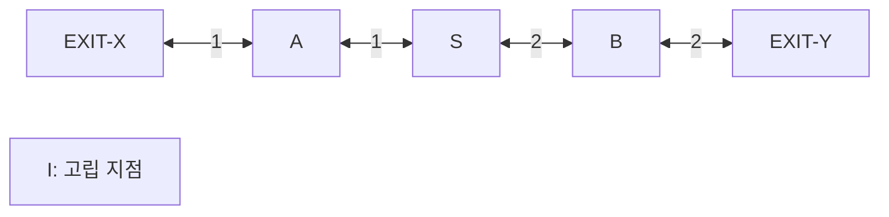

# saferoute 통합 시험·시연 시나리오서

[개발계획서](02-development-plan.md) · [요구사항](03-requirements-spec.md) · [인터페이스](05-data-interface-spec.md) · [AI 평가](06-ai-development-evaluation-plan.md)

이 문서는 시험 입력, 독립 기대 결과, 수행 순서, 판정·증거 양식을 정의한다. **현재 모든 시험은 미실행**이다. 표의 기대값은 시험 정답이며 실제 측정 결과가 아니다.

## 1. 시험 원칙

1. 작은 검증 그래프와 실제 건물 모델을 구분한다. 작은 그래프를 원주미래산업진흥원 구조로 소개하지 않는다.
2. 5번이 기대 결과를 먼저 작성하고 2번 구현 결과와 비교한다.
3. 정답 연기 상태와 제어기에 실제 전달한 관측을 별도로 기록한다.
4. 알려진 위험을 경로에서 배제하는지와 관측하지 못한 위험이 얼마나 남는지를 분리한다.
5. 화면·ACK·로그를 함께 확인한다. HTTP 200만으로 단말 적용을 판정하지 않는다.
6. 모든 지점을 안내 불가로 만드는 구현이 통과하지 못하도록 정상 경로 제공 사례를 포함한다.
7. 실패·미수행·자료 부족을 기록하고 성공 사례만 선별해 전체 성능으로 발표하지 않는다.
8. 시연에서는 실제 불을 만들거나 소방 설비를 작동시키지 않는다.

## 2. 시험 준비

### 2.1 사전 조건

- C01·C02 완료, 핵심 환경·API·단말 사용 가능.
- 공간·시나리오·기대 결과의 버전 일치.
- 입력 생산자와 제어기는 같은 서버/PC에서 실행.
- 시연 설정·모델·영상·코드 commit 고정.
- 단말 2개를 서로 다른 sign_id로 실행.
- 서버·클라이언트의 화면과 로그를 확인할 담당 배치.
- 실제 AI 시험은 지원 모델·영상이 확보된 경우 수행. 미확보면 V01 미실행.

### 2.2 새 실행 순서

1. 이전 AI·시나리오를 종료한다.
2. 이전 run_id의 로그를 보존하고 reset 또는 제어기 재시작으로 새 실행을 만든다.
3. 설정·자료 검증 후 시나리오를 준비한다.
4. 시나리오는 초기 정상 관측을 보내며 arm 전에는 주요 시간표를 진행하지 않는다.
5. 현재 run_id로 arm한다. 이때를 시나리오 t=0으로 한다.
6. 단말이 새 실행 명령을 받은 것을 확인한 뒤 시험을 수행한다.
7. 시험 종료 후 로그·화면·판정 파일을 같은 run_id에 연결한다.

## 3. 독립 시험 그래프

### 3.1 구조

`data/fixtures/two-route-v1.json`에 다음을 구현한다. building_id는 TWO_ROUTE, building_version은 1이다.

모든 양방향 연결은 각각의 방향 edge 두 개로 저장한다. 각 방향 비용은 그림의 값과 같다.

| 노드 | 모델 위치 x,y,z | 구역 | 의미 |
| --- | --- | --- | --- |
| S | 0,0,0 | Z-S | 시작·분기 |
| A | -1,0,-1 | Z-A | 왼쪽 통로 |
| B | 1,0,-1 | Z-B | 오른쪽 통로 |
| X | -1,0,-2 | Z-X | EXIT-X |
| Y | 1,0,-2 | Z-Y | EXIT-Y |
| I | 3,0,0 | Z-I | 다른 노드와 연결 없음 |

`Z-A`의 위험은 A와 접속 edge를 제거한다. `Z-B`의 위험은 B와 접속 edge를 제거한다. S·X·Y·I의 별도 위험 시험은 해당 노드를 차단한다.

| 관측원 | 유형 | 구역 | 필수 관측 |
| --- | --- | --- | --- |
| CAM-A | VIDEO_AI | Z-A | 아니오. 실제 AI·계약 시험용 |
| DETECTOR-A | SIM_SMOKE_DETECTOR | Z-A | 예 |
| SPRINKLER-A | SIM_SPRINKLER | Z-A | 아니오 |
| DETECTOR-B | SIM_SMOKE_DETECTOR | Z-B | 예 |

sign_id SIGN-S는 S에 설치하고 FRONT에서 A=LEFT, B=RIGHT로 매핑한다. 반대 표시면 REAR는 A=RIGHT, B=LEFT로 별도 검사한다. 기본 다음 지점은 A다.

SIGN-B는 B에 설치하고 FRONT에서 Y=FORWARD, S=BACK으로 매핑한다. 기본 다음 지점은 Y다. 이 방향 매핑은 검증용 좌표·표시면 정의이며 실제 건물 설비 배치가 아니다.

### 3.2 독립 기대 결과

| 사례 | 입력 조건 | S의 기대 결과 | 함께 확인 |
| --- | --- | --- | --- |
| G01 | 모든 필수 관측 유효, 위험 없음 | S→A→X, 비용 2, 기본 LEFT | B→Y, I는 도달 불가 |
| G02 | A 위험 | S→B→Y, 비용 4, 동적 RIGHT | A는 ORIGIN_BLOCKED |
| G03 | B 위험 | S→A→X, 비용 2 | B는 ORIGIN_BLOCKED |
| G04 | A·B 위험 | S는 NO_REACHABLE_EXIT | 이전 LEFT/RIGHT 제거 |
| G05 | S 위험 | ORIGIN_BLOCKED | 임의 탈출 경로 생성 금지 |
| G06 | EXIT-X 비활성, 나머지 정상 | 동적 계산 시험에서 S→B→Y | 비활성 목적지 사용 금지 |
| G07 | A 경보 유지, DETECTOR-B 만료 | S 안내 불가 | B의 관측 불확실성 제외 |
| G08 | A의 원인 2개 중 1개만 해제 | S→B→Y 유지 | 나머지 원인 표시 |
| G09 | A의 모든 원인 해제, B 정상 | 조건 확인 후 기본 LEFT | 미검출만으로 G09가 되지 않음 |
| G10 | 두 경로 비용을 모두 2로 만든 변형 | 동률 규칙에 따라 EXIT-X 선택 | edge 배열 순서 바꿔도 동일 |

G06은 출구 조건을 바꾼 별도 실행의 경로 함수 시험으로 수행한다. 평상시 기본 안내가 비활성 출구로 향한다면 설정 검증에서 거부하거나 새 기본 매핑으로 바꾸고 새 실행을 시작한다. 잘못된 기본 표시를 정상으로 허용하지 않는다.

정답 파일은 사람이 위 표·그래프를 보고 작성한다. 전체 그래프의 노드별 다음 지점·도달 가능 여부·사유를 포함하며 S 하나만 비교하지 않는다.

B02의 백엔드 회귀 시험은 [routing-cases.json](../tests/fixtures/routing-cases.json)에 이 표의 전체 노드 정답을 고정하고 [test_routing.py](../tests/test_routing.py)에서 비교한다. 유도등 표시·명령·단말 적용과 Q02의 통합 시연 자료 검수는 이 경로 시험만으로 완료 처리하지 않는다.

## 4. 연기 변화 시간표

`data/scenarios/two-route-smoke.json`의 기본 시연이다. 정상 상태를 확인한 arm 시점부터 시간표를 진행한다. 가상 감지기의 예시 임계값 0.5는 **시나리오 표현값**이며 실제 농도 기준이 아니다.

| 시각 | 시험 정답·조작 | 제어기에 전달되는 정보 | 기대 |
| --- | --- | --- | --- |
| 준비 | 모든 필수 모의 관측 준비 | 초기 정상 상태·주기 상태 확인 | INITIALIZING, arm 대기 |
| t=0 | 시연 시작 | arm | 기본 LEFT, B는 FORWARD |
| t=10s | A 연기 표현 0.4 | 아직 임계값 미충족 | 연기는 보이지만 경보 없음 |
| t=15s | A 표현 0.7 | 모의 감지 생성, 2초 지연 | 정답과 관측 차이 표시 |
| t=17s 이후 | A 위험 지속 | DETECTOR-A의 SMOKE 경보 수신 | S가 B 쪽 RIGHT로 변경 |
| t=25s | B 표현 0.7 | 모의 감지 생성, 2초 지연 | 아직 관측 전 상태와 구분 |
| t=27s 이후 | A·B 위험 | DETECTOR-B 경보 수신 | S 안내 불가 |
| t=35s | A 표현값 0으로 감소 | 정상 관측, 확인 해제 없음 | A 경보 유지, S 안내 불가 |
| t=40s | 운영자가 A 원인을 확인 해제 | DETECTOR-A·SMOKE만 clear | B 경보 유지, S→A→X |
| 종료 | 시연 완료 | 시나리오 completed, 이후 입력 중단 | 새 관측 없으면 계약대로 만료 |

시각은 시나리오 예정값이다. 실제 전달·계산·표시 시각은 별도로 측정한다. 화면이 정확히 17.000초에 바뀐다고 미리 성능을 주장하지 않는다.

추가 변형은 A 관측을 누락하는 경우다. 제어기가 정답을 직접 읽어 미리 우회하면 실패다. 관측 누락 동안의 정답 기준 위험 노출은 숨기지 않고 기록한다. 이 사례는 감지되지 않은 위험까지 알고리즘이 해결한다는 주장을 막기 위한 시험이다.

## 5. 필수 검증 사례

### V01 — 실제 영상 AI

**관련:** F01. **담당:** 1번 실행, 5번 검수.

- 정상·불꽃·연기 영상을 실제 모델로 추론한다.
- 모델·영상 해시, 클래스·confidence·영상 위치·관측 시각을 남긴다.
- 실제 VIDEO_AI 이벤트가 제어기에 들어가는지 확인한다.
- 적어도 불꽃·연기 입력 유형 각각의 연결을 확인한다.

**통과:** 실제 추론 근거와 수신 로그 일치. 정확도·재현율은 06번 평가로 별도 판정.  
**증거:** ai-predictions.jsonl, events.jsonl, 모델·영상 manifest.  
**실패:** 수동 입력만 사용, 모델 지원 미확인, 출처 혼동.

### V02 — 독립 설비 신호

**관련:** F02. **담당:** 2·5번.

- 다른 경보가 없는 새 실행에서 DETECTOR-A만 작동시킨다.
- 별도 새 실행에서 SPRINKLER-A만 작동시킨다.
- 각 입력만으로 A를 제외한 경로를 생성하는지 확인한다.

**통과:** 두 종류가 각각 독립적인 원인으로 반영.  
**실패:** AI와 동시에 감지해야만 동작하거나 스프링클러를 정확한 발화 좌표로 취급.

### V03 — 경보 유지·해제·유효성

**관련:** F03. **담당:** 2·5번.

1. CAM-A의 FIRE와 DETECTOR-A의 SMOKE를 활성화한다.
2. CAM-A에 정상 미검출·EOF를 전달한다.
3. FIRE 확인 해제를 요청한다.
4. SMOKE 확인 해제를 요청한다.

**통과:** 2에서 두 원인 유지·영상 유효성만 변경, 3에서 SMOKE 유지, 4에서 마지막 원인 해제. 필수 관측이 부족하면 정상 복귀하지 않음.  
**증거:** 원인별 전후 상태·clear 사유·관측 만료 기록.

### V04 — 경로 정확성과 제공 여부

**관련:** F04. **담당:** 2번, 5번 독립 비교.

G01~G03·G06·G10을 시험한다. 양수 비용·방향 그래프에서 모든 다음 지점을 따라 출구에 도달하는지 확인한다. 입력 배열을 바꿔 동률 결과도 확인한다.

**통과:** 기대 경로가 있는 지점의 경로 제공, 알려진 차단 통과·순환·잘못된 출구 0건.  
**실패:** 전부 안내 불가, 위험 edge에 큰 비용만 부여해 통과.

### V05 — 안내 불가

**관련:** F04. **담당:** 2·5번.

G04·G05·G07과 고립 노드 I, 모든 출구 비활성, 필수 관측 누락을 시험한다.

**통과:** 다음 지점 null과 구체적 사유. 이전 방향 제거.  
**실패:** “안전”·“대기”로 표현하거나 없는 통로 생성.

### V06 — 표시면·명령·ACK

**관련:** F05·F10. **담당:** 2·3·4·5번.

- SIGN-S의 FRONT·REAR와 SIGN-B를 확인한다.
- 같은 다음 지점이라도 면에 맞는 표시인지 본다.
- 다른 sign_id·잘못된 face·변조된 ACK를 보내 거부를 확인한다.
- 계단 표시는 실제 건물의 별도 표시면 사례로 확인한다.

**통과:** 발행 명령·화면·유효 ACK 일치. 두 ID의 적용 상태를 구분.  
**실패:** HTTP 수신만으로 APPLIED, 같은 ID 두 창을 두 유도등으로 집계.

### V07 — 건물·그래프 검수

**관련:** F06. **담당:** 4번, 5번 교차 확인.

1~3층 공개 안내도와 모델·노드·통로·계단·출구를 대조한다. 벽 관통, 다른 계단 연결, 출구 오지정, 반대 면 표시를 점검한다.

**통과:** 기본 구조·경로 연결·표시면 대응과 가정 목록 확보.  
**실패:** PDF 콘셉트 그림을 실측 모델로 사용하거나 우회 시연을 위한 통로 추가.

### V08 — 연기 변화와 관측 분리

**관련:** F09. **담당:** 2·3·5번.

4절의 정상 지연 사례와 관측 누락 변형을 실행한다. 관제의 연기 상태와 제어기의 관측 상태·시각을 비교한다.

**통과:** 정답→관측 생성→수신→판단→명령 순서 확인. 누락 시 제어기가 미래 정답을 사용하지 않음.  
**증거:** 시나리오 정답 로그, 관측 로그, 판단·단말 적용.  
**실패:** 프론트 타이머로 경로 전환, backend의 /sim/state 조회, 정답 경로 입력.

### V09 — 단말 단절·역순·만료

**관련:** F08·F10. **담당:** 3번, 2·5번 지원.

- 단말 하나의 네트워크를 끊고 다른 단말은 유지한다.
- 만료 후 이전 화살표 제거를 확인한다.
- 낮은 command_sequence, 지난 run_id, 다른 sign_id, 늦게 도착한 명령을 주입한다.
- 재연결 후 새 session·명령을 받은 뒤 복구하는지 확인한다.
- 백그라운드·절전 복귀를 별도로 확인한다.

**통과:** 무효 명령 적용 없음, 일부 단말 미적용 표시, 신선한 명령으로만 복구.  
**제한 기록:** 브라우저 타이머가 멈춘 구간과 실제 표시 확인 시점. 물리 장치 시간 보장으로 해석하지 않음.

### V10 — 영상·관제 종료

**관련:** F01·F08. **담당:** 1·2·3·5번.

활성 경보 후 영상을 종료한다. 관측 불가와 경보 유지가 함께 나타나는지 확인한다. 관제 연결을 끊고 제어·단말의 지속 동작도 확인한다.

**통과:** EOF를 정상 해제로 사용하지 않음, 관제 단절과 제어기 단절을 구분.

### V11 — 관제 없는 제어

**관련:** F10. **담당:** 2·3·5번.

관제·3D 창을 모두 닫고 별도 단말 2개만 남긴다. 독립 시나리오 또는 CLI로 새 관측을 전달한다.

**통과:** 위험·경로·단말·ACK·로그가 계속 갱신.  
**실패:** 관제 종료 시 입력·시간 진행·경로 갱신도 중단.

### V12 — 초기화·반복·기록

**관련:** F07. **담당:** 2·5번.

같은 시나리오·seed·설정으로 두 새 실행을 수행한다. 각 실행의 이벤트 순서에 따른 판단 결과를 비교한다. 지난 실행의 이벤트·명령·ACK를 다시 전송한다.

**통과:** 같은 입력에 같은 판단, 새 run_id, 이전 기록 보존, 지난 실행 거부. 실제 지연은 다를 수 있으며 수치를 별도로 기록.  
**실패:** reset이 로그 삭제, 이전 경보 재전송이 새 실행을 변경.

### V13 — 서버 배포·복구

**관련:** N06·N08. **담당:** 2번 배포, 5번 다른 PC 검수.

- 지원 서버의 실제 자원·서비스·commit·설정을 확인한다.
- 팀 전용 터널에서 실제 배포본에 접속한다.
- SSH 관리 창 종료 후 서비스 유지, 터널 단절 시 단말 만료를 확인한다.
- 제어기 재시작 후 새 실행·관측 준비·명시적 arm을 확인한다.
- 내부 API 포트가 loopback에만 바인딩되었는지 확인한다.
- 공개 URL이 요구되면 인증·읽기/쓰기 구분·HTTPS·공개 접속도 시험한다.

**통과:** 해당 배포 범위의 실제 접속·지속 실행·복구 근거.  
**미정 처리:** 공개 접속이 정해지지 않았다면 “팀 전용 배포 통과, 공개 URL 미정”으로 기록.

### V14 — S3·자료 보존

**관련:** N07·N09·N12. **담당:** 5번, 2번 지원.

선별 로그·설정·자료를 제공 버킷에 업로드하고 별도 경로로 다시 내려받아 해시를 비교한다. GitHub 소스와 PC 사본, PEM 제외, 사용 조건을 확인한다.

**통과:** 동일 자료 복원·로컬 사본·제출 버전 확인.  
**실패:** S3에 올렸다는 출력만 있고 복원 확인 없음, 행사 종료 시 삭제되는 서버에만 자료 존재.

### V15 — Bedrock 설명의 근거·버전·장애 격리

**관련:** F11. **담당:** 1번 작업자, 2번 API·배포, 3번 표시, 5번 독립 검수.

1. G01·G02·G04·G07·G09 상태를 실제 Bedrock에 전달한다. 각 문장의 원인·차단 구역·경로·안내 불가 사유가 입력과 일치하는지 사람이 대조한다. 모델 이름·프롬프트·사실 ID·시각·토큰을 기록한다.
2. 정상 응답의 근거 ID가 현재 사실 목록에 포함되는지 확인한다. 미등록 ID·빈 설명·잘못된 JSON·새로운 경로/안전 단정을 실패 사례로 기록한다. 형식 통과만으로 설명 품질 통과라고 하지 않는다.
3. 요청 중 새 경보·clear·reset을 발생시킨다. 이전 실행·건물·안내 버전 응답은 표시하지 않고 최신 상태를 기다려야 한다. 기한이 지난 설명을 다시 받더라도 수명을 새로 시작하지 않는다.
4. 권한 거부·429·timeout·설명 로그 실패·설명 작업자 종료를 주입한다. 설명은 UNAVAILABLE 또는 조회 실패로 표시하되 실제 감지→경로→유도등 명령→ACK가 유지되는지 확인한다. Bedrock 장애가 제어기 503을 만들면 실패다.
5. 관제에서 PENDING/READY/UNAVAILABLE·AI 작성 표시·근거 버전/시각을 구분한다. 설명과 별개로 현재 위험·이동 방향·단말 적용 결과를 읽을 수 있어야 한다.

**통과:** 실제 호출 근거와 문장별 대조, 지난 버전/기한 결과 표시 없음, 설명 장애 중 제어 지속. 
**실패:** 모의 설명만으로 실제 Bedrock 완료 표시, 미감지를 안전으로 서술, 새 통로·이동 지시·경보 해제 생성, 설명을 제어 입력으로 사용. 
**증거:** explanations 로그·원본 제어 스냅샷·화면·같은 실행의 명령/ACK. 미구현 단말은 시험 미완료로 남긴다.

## 6. 측정 지표

| 지표 | 계산 기준 | 주의 |
| --- | --- | --- |
| 관측 기준 경로 위반 | 실제 수신 위험·필수 관측 불가를 경로가 통과한 건수 | 시뮬레이션 정답과 별도 |
| 경로 제공률 | 기대 경로가 있는 노드·판단 중 경로 제공한 수 / 해당 전체 수 | 항상 안내 불가 방지 |
| 불필요한 안내 불가 | 기대 경로가 있는데 안내 불가를 반환한 건수 | 원인도 기록 |
| 정답 기준 잔여 위험 | 시나리오 위험과 현재 안내가 겹친 구간·지속시간 | 감지 지연·누락의 영향 포함 |
| 제어 계산 지연 | 서버 수신부터 상태·경로 스냅샷 생성까지 | 같은 서버 monotonic |
| 명령 전달·적용 확인 | 서버 수신 또는 발행부터 유효 ACK 수신까지 | 네트워크·조회 대기·ACK 왕복 포함 |
| 단말 내부 적용 | 단말 응답 수신부터 UI 반영까지 | 클라이언트 시계 내부에서만 비교 |
| 혼합 안내 버전 | 새 버전 발행부터 대상 단말이 모두 적용하거나 실패 확정할 때까지 | 미적용 단말을 분모에서 제거하지 않음 |
| 3D 반영 | 서버 스냅샷과 관제 표시의 대응 시각 | 단말 성능과 별도 |
| AI 성능 | 06번의 클래스별 TP·FP·FN·지연·오탐 | 모의 입력 제외 |
| Bedrock 설명 | 문장/근거 불일치·기한/버전 폐기·호출 지연·실패·토큰 | 감지 정확도와 구분, 원본 입력과 사람 대조 |

성공한 응답만으로 지연 분포를 만들지 않는다. timeout·미적용 수를 함께 제시한다. 서버의 ACK 왕복 지연을 화면이 실제로 켜진 정확한 순간이라고 표현하지 않는다.

성능 목표·반복 횟수·단말 수·장비·영상·동시 실행 수는 평가 전에 고정한다. 초기에 한 번 성공한 결과는 기능 확인이며 통계적 신뢰도 입증이 아니다.

## 7. 결과 기록 양식

| 필드 | 기록 |
| --- | --- |
| test_id / case_id | V번호와 G번호 또는 시나리오 ID |
| 상태 | 미실행 / 통과 / 실패 / 차단 / 일부 수행 |
| 실행자·검수자·UTC 일시 | 실제 수행 후 입력 |
| run_id·코드 commit | 실제 값 |
| 건물·시나리오·모델·설정 해시 | 실제 값 |
| 환경·단말 수·네트워크 | 실제 조건 |
| 입력·장애 주입 | 재현 가능한 순서 |
| 기대 결과 | 시험 전 작성 |
| 실제 결과 | 실제 관찰·로그 |
| 증거 | 입력·판단·명령·ACK·화면 경로 |
| 측정값·분모·미측정 | 실패·누락도 포함 |
| 결함·담당·재시험 | 수정 전후 구분 |

확인되지 않은 값을 0으로 채우지 않는다. 아직 수행하지 않았으면 미실행·미측정으로 남긴다.

## 8. 시연 진행안

공식 본선은 2026-11-14(토), 발표 8분·질의응답 5분이다. 제출 영상은 2~3분 이내로 핵심 흐름을 압축한다. 아래는 시연 순서이며 실제 연습으로 시간을 배분한다. 출처는 [참가자 심사 기준](https://app.hackathon.tbitcloud.com/criteria)과 [공식 대회 안내](https://hackathon.tbitcloud.com/northeast-oss), 2026-11-08 확인이다.

1. 목적 설명: 지정 주제인 AI 기반 재난 대응 행동요령 안내를 화재 상황의 다음 이동 방향 안내로 구현했다. 유도등 제어가 제품이고 장치 I/O·3D는 검증용 대체 환경이다.
2. 화면 소개: 실제 모델 추론, 제어 상태, 3D 시험 정답, 별도 단말을 구분한다.
3. 정상 상태: 기본 안내와 단말 ID·버전을 확인한다.
4. 실제 영상 감지: 오픈소스 모델의 FIRE 또는 SMOKE 근거와 경로 변경을 보여준다. 같은 버전의 Bedrock 상황 설명과 실제 방향 표시를 함께 대조한다.
5. 연기 변화: 모의 연기와 가상 관측 지연을 보여주고 새 관측 후 재계산을 확인한다.
6. 경로 없음: 모든 유효 경로가 막히면 화살표를 임의로 유지하지 않는 것을 보여준다.
7. 독립 제어: 관제를 닫고 별도 단말이 계속 동작함을 보여준다.
8. 장애: 단말 단절·만료 또는 영상 종료와 경보 유지 사례를 보여준다. Bedrock 응답 실패 중에도 경로·단말이 유지되는 사례를 확인한다.
9. 증거: 명령·ACK·서버 배포·측정 결과와 한계를 제시한다.

실제 건물의 우회 가능성이 확인되지 않으면 작은 그래프에서 우회 원리를, 실제 건물에서 구조 기반 판단을 따로 보여준다. 실제 건물에 가짜 통로를 추가하지 않는다.

## 9. 시연 실패 시 대응

| 상황 | 대응 | 설명 원칙 |
| --- | --- | --- |
| 네트워크·지원 서버 불가 | 같은 고정 버전의 로컬 실행 또는 사전 기록 사용 | 현재 서버 동작이 아닌 대체 시연임을 밝힘 |
| 실제 AI 미검출 | 실패 근거를 기록하고 모의 입력으로 제어만 별도 설명 | 모의 입력을 AI 성공으로 소개하지 않음 |
| Bedrock 지연·실패 | 설명을 준비 중/제공 불가로 표시하고 구조화된 상태·방향으로 시연 | 이전 설명·고정 문구를 현재 AI 응답으로 소개하지 않음 |
| 단말 적용 실패 | 실패 상태·로그를 보여주고 재연결 절차 수행 | 전체 성공으로 덮지 않음 |
| 3D 느림 | 단순 모델·기본 연기·2D 상태로 진단 | 필수 3D 검증 미완료 여부를 별도 기록 |
| 시연 초기화 필요 | 공급자 종료→새 실행→초기 관측→arm | 이전 로그 보존, 경보 자동 해제로 위장하지 않음 |

사전 영상은 실제 수행한 실행에서 제작하고 버전·조건을 남긴다. 녹화 자료만으로 현재 배포본이 동작 중이라고 말하지 않는다.
